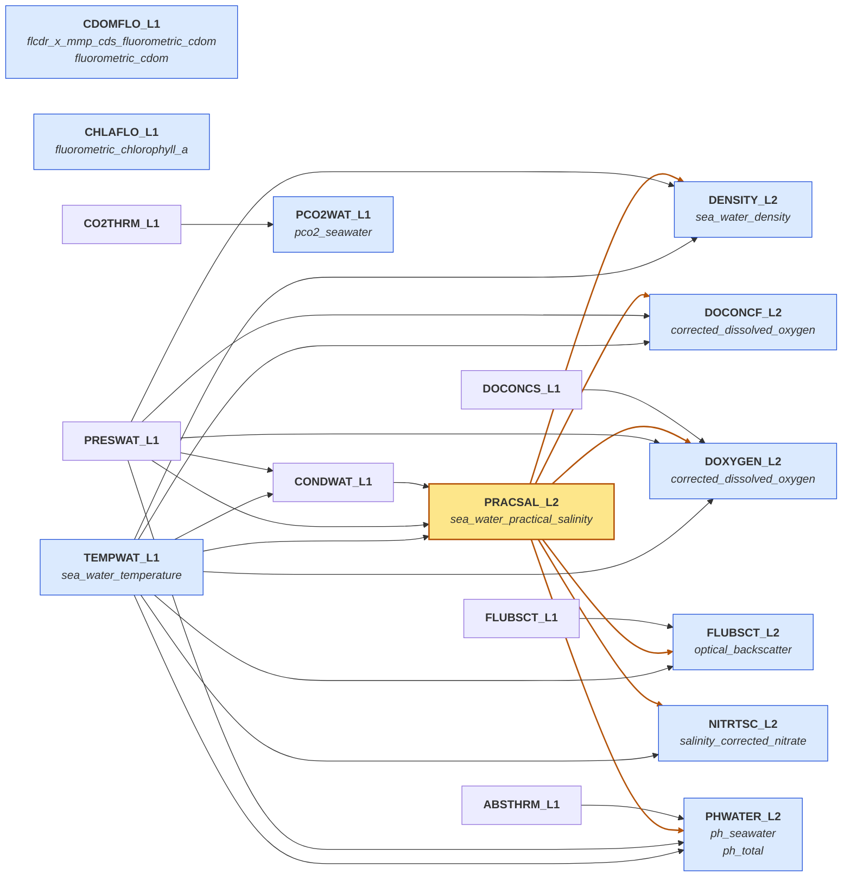

# Parameter dependencies

How OOI computes the variables in our products, drawn from the
[preload database](https://github.com/oceanobservatories/preload-database) `ParameterDefs.csv`
(`master` as of 2026-10-23). Each box is an OOI data product (DPI); arrows point from an
input to the product computed from it. Blue boxes feed our products (our variable names in
italics). Practical salinity (`PRACSAL_L2`, amber) is the main shared input: a bad salinity
also corrupts every product it points to, which is what `common.inherit_params` handles. An arrow
means "used in", not "strongly affected by": see the sensitivity table in `CLAUDE.md` (e.g. PHSEN
`ph_seawater` changes only ~0.002 pH per unit salinity). Unlinked boxes depend only on their own
sensor and calibration.
Calibration constants, raw L0 counts, and surface-mooring / OPTAA branches are omitted.

Regenerate: `python -m rca_cicoes_cresst.param_graph`

