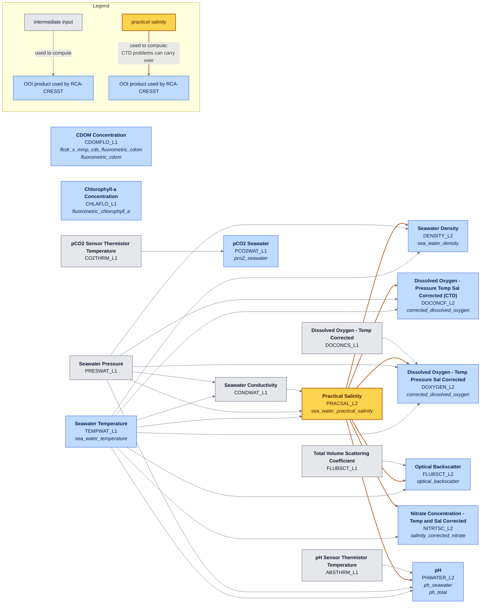

# Parameter dependencies

How OOI computes the variables RCA-CRESST products are built from, drawn from the
[preload database](https://github.com/oceanobservatories/preload-database) `ParameterDefs.csv`
(`master` as of 2026-10-28). Each box is an OOI data product (DPI), labelled with OOI's
display name and DPI code; arrows point from an input to the product it is used to compute. Blue boxes
are OOI products used by RCA-CRESST (variable names in italics); grey boxes are intermediate inputs; unlinked
boxes depend only on their own sensor and calibration. Calibration constants, raw L0 counts, and
surface-mooring / OPTAA branches are omitted.

Regenerate: `python -m rca_cicoes_cresst.param_graph`

## In plain language

Most ocean sensors don't measure the quantity we want directly. They measure something
easier (a voltage, a color, a glow) and convert it, and the conversion usually needs to know the
water's temperature, saltiness and pressure. Those three come from the CTD, so the CTD sits
upstream of almost everything else.

**The CTD** (Conductivity, Temperature, Depth) measures three things:

- **Temperature**, with a thermistor.
- **Pressure**, which tells you depth.
- **Conductivity**: how well the water carries electricity. Salty water conducts better, but so
  does warm water.

From these it computes two more:

- **Salinity** (how salty the water is) comes from conductivity, corrected for temperature and
  pressure. Salinity is never measured directly, so a problem with the conductivity sensor, such
  as a bit of biology clogging it, shows up as wrong salinity.
- **Density** (how heavy a given volume of water is) comes from temperature, salinity and
  pressure.

The other instruments then lean on the CTD:

| Measurement | What the sensor actually senses | What it needs from the CTD | Effect of a bad salinity |
|---|---|---|---|
| Dissolved oxygen | Optode: how quickly a glowing dye fades, which oxygen speeds up. SBE 43: a current through a membrane. | Temperature; salinity and pressure, because salty water holds less oxygen and the result is reported per kilogram of seawater | Small but real (~0.7% per unit of salinity); masked |
| Nitrate | How much ultraviolet light the water absorbs | Temperature and salinity, because sea salt also absorbs UV and has to be subtracted | Large; masked |
| pH, SeapHOx (shelf) | Voltage across a solid-state electrode | Salinity from its own built-in CTD, which sets the chemistry of the reference electrode | Moderate (~0.015 pH per unit); masked |
| pH, PHSEN (everywhere else) | The color of an indicator dye | Its own thermometer; salinity only weakly | Below the sensor's precision; not masked |
| Backscatter | Light bounced back by particles | Temperature and salinity, to subtract light scattered by the water itself | Negligible; not masked |
| pCO₂ | The color of an indicator dye | Nothing; it has its own thermometer | None |
| Chlorophyll, CDOM | Fluorescence: light the water glows back when lit | Nothing | None |

So when the CTD's salinity goes bad, oxygen, nitrate and SeapHOx pH on the same platform go
bad with it, even if their own sensors are fine. The products mask those automatically. A
temperature or pressure problem would spread the same way, but those sensors rarely fail on
their own.

## Diagram

## Salinity inheritance

Practical salinity (`PRACSAL_L2`, amber) is the main shared input, so a CTD conductivity
clog or drift also affects the products it points to on the same node. An arrow means "used in",
not "strongly affected by":

| Mask | Error per unit salinity | Why |
|------|-------------------------|-----|
| `sea_water_practical_salinity`, `sea_water_density` | density -0.79 kg/m3 | computed directly |
| `corrected_dissolved_oxygen`, `dissolved_oxygen` | ~0.7% | Garcia & Gordon salinity correction, umol/L -> umol/kg |
| `ph_total` (PHSENH, ISFET) | ~0.015 pH | chloride / sulfate / ionic-strength terms |
| `salinity_corrected_nitrate` | large | sea-salt (bromide) absorbance subtraction |

Not masked: temperature (Sea-Bird: fouling doesn't affect the thermistor), PHSEN
`ph_seawater` (~0.002 pH per unit salinity, below sensor uncertainty), pCO2, chlorophyll,
CDOM, backscatter. Exception: on pumped profiling CTDs, a pump failure may also affect
temperature response.

Clogs are usually abrupt multi-unit steps (annotation 6394: -2.45 for 10 weeks), not slow
drift. BGC-Argo flags O2/NO3/pH as suspect (3) when salinity is bad; RCA-CRESST products keep good
data only, so they mask. `common.inherit_params` adds these at load time, so ledger rows only
need the base parameters. It reads the list from preload (every variable downstream of
`PRACSAL_L2`) less `common.SALINITY_INSENSITIVE` (PHSEN `ph_seawater`, backscatter).
