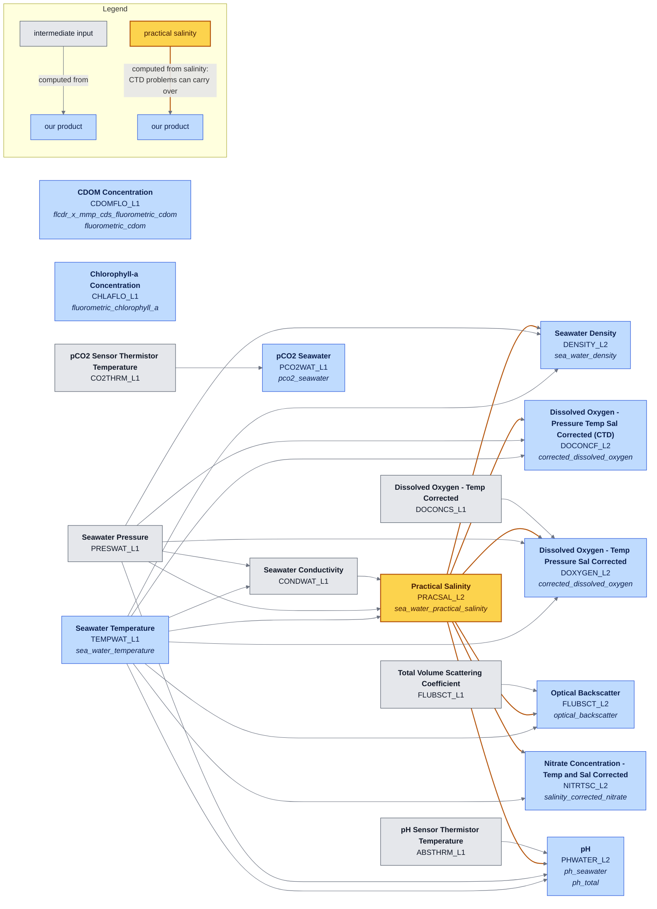

# Parameter dependencies

How OOI computes the variables in our products, drawn from the
[preload database](https://github.com/oceanobservatories/preload-database) `ParameterDefs.csv`
(`master` as of 2026-10-23). Each box is an OOI data product (DPI), labelled with OOI's
display name and DPI code; arrows point from an input to the product computed from it. Blue boxes
are our products (our variable names in italics); grey boxes are intermediate inputs; unlinked
boxes depend only on their own sensor and calibration. Calibration constants, raw L0 counts, and
surface-mooring / OPTAA branches are omitted.

Regenerate: `python -m rca_cicoes_cresst.param_graph`

## Salinity inheritance

Practical salinity (`PRACSAL_L2`, amber) is the main shared input, so a CTD conductivity
clog or drift also affects the products it points to on the same node. An arrow means "used in",
not "strongly affected by":

| Mask | Error per unit salinity | Why |
|------|-------------------------|-----|
| `sea_water_practical_salinity`, `sea_water_density` | density -0.79 kg/m3 | computed directly |
| `corrected_dissolved_oxygen`, `dissolved_oxygen` | ~0.7% | Garcia & Gordon salinity correction, umol/L -> umol/kg |
| `ph_total` (PHSENH, ISFET) | ~0.015 pH | chloride / sulfate / ionic-strength terms |
| `salinity_corrected_nitrate` | large | sea-salt (bromide) absorbance subtraction |

Not masked: temperature (Sea-Bird: fouling doesn't affect the thermistor), PHSEN
`ph_seawater` (~0.002 pH per unit salinity, below sensor uncertainty), pCO2, chlorophyll,
CDOM, backscatter. Exception: on pumped profiling CTDs, a pump failure may also affect
temperature response.

Clogs are usually abrupt multi-unit steps (annotation 6394: -2.45 for 10 weeks), not slow
drift. BGC-Argo flags O2/NO3/pH as suspect (3) when salinity is bad; our products keep good
data only, so they mask. `common.inherit_params` adds these at load time, so ledger rows only
need the base parameters.
